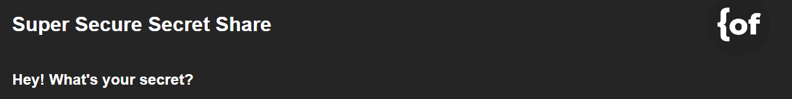
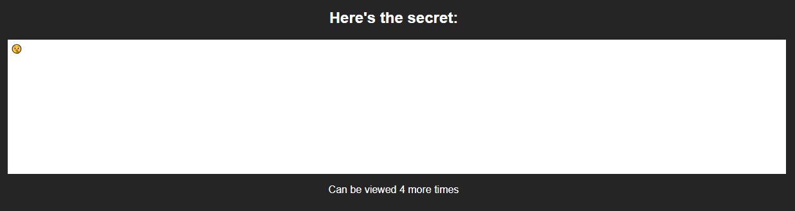

# About Secret Share

Ever wanted to ask a client for a password to their account? Need to get an access code but don't want it stuck in some email log? Use this. Using Secret-Share you can send a link containing the secret you want to share. Once you're done with a secret, it's gone.

# Get Started

This program is built using Go, so you'll need to build and host it.

Your first step is to navigate to the `./frontend` folder in the terminal. From there, run `npm install` to install all Vue.js dependencies.

Next, navigate back to the project root and run the `./build.sh` script. Finally, put the binary that makes sense for your server out there. Run it as a systemd script, inside of `shell` or however windows works.

# Linking Emails

To secret share via email you'll have to add emails to the `.env` file. Just add them to the `RECIPIENTS` variable and that's it! It should look something like this:

`RECIPIENTS=John:john@example.com,Jane:jane@example.com`

# Customizing

Nothing about the look of the site is built into the binary. Branding and styling are set per deployment in the `.env` file, and the defaults live in `.env.example` and the [`theme/`](theme/) folder.

| Env var | What it sets |
| --- | --- |
| `SITE_TITLE` | page heading and browser tab title |
| `LOGO_PATH` | logo image file, served at `/logo` (no logo shown when unset) |
| `LOGO_ALT` | logo alt text |
| `FAVICON_PATH` | favicon file, served at `/favicon.ico` |
| `THEME_COLOR` | mobile browser chrome color |
| `THEME_CSS_PATH` | stylesheet with every color, font and size |

Paths are files on the server, relative to the directory the binary runs from. They are read from disk on every request, so edits show up on the next page load without a restart.

## Custom stylesheet

To restyle the site, copy [`theme/default.css`](theme/default.css), change the CSS variables you care about, and point `THEME_CSS_PATH` at your copy. It loads after the built-in styles, so you can also add any other CSS rules (layout tweaks, hiding elements, custom fonts with `@import`). If `THEME_CSS_PATH` is unset, the site is unstyled.

# Start Sharing!

Now you'll be able to send secrets! They can either be directly emailed to someone, or you can copy a generated link and send however you'd like.
